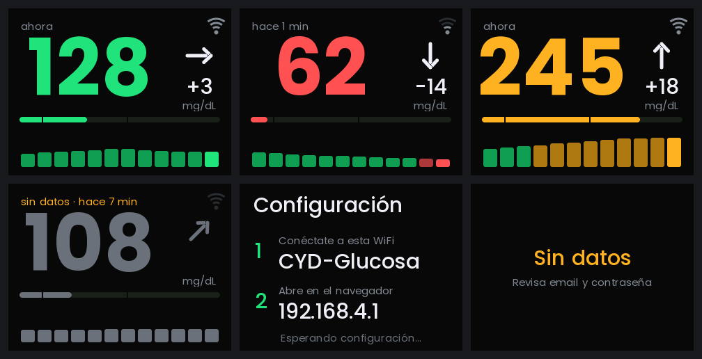

# Glucosa CYD · LibreLinkUp y Dexcom (v4)

Muestra tu glucosa en una placa **CYD (ESP32-2432S028R)**: valor grande, tendencia, variación,
barra de rango y últimas lecturas. Funciona con **FreeStyle Libre (LibreLinkUp)** y con **Dexcom
(G7, G6, ONE+)**. Se conecta directamente por WiFi, sin hub ni app, y **se instala desde el navegador**.



*Vista previa simulada de la interfaz (valores de ejemplo).*

> **Aviso:** usa las APIs no oficiales de LibreLinkUp y Dexcom Share y no es un producto sanitario. No sustituye al
> lector ni a la app oficiales; no tomes decisiones de tratamiento solo con esta pantalla.

Basado en [mulscully/CYD_LibreLinkUp_glucose_ConfigScreen](https://github.com/mulscully/CYD_LibreLinkUp_glucose_ConfigScreen) (MIT).

## Qué hay de nuevo respecto al original

- **Soporte para Dexcom** (Share) además de LibreLinkUp: se elige el servicio en el portal de configuración.
- **Páginas de ayuda** `librelink.html` y `dexcom.html` en el instalador, con los pasos para crear o
  configurar la cuenta de cada servicio.
- **Hora real de la lectura**: la placa sincroniza la hora (NTP) y calcula cuántos minutos tiene la
  lectura del sensor; pasados 15 minutos la marca en gris como «sin datos».
- **Protección de cuenta**: tras un fallo de usuario/contraseña espera 5 min, y a los 3 fallos seguidos
  deja de intentarlo (Dexcom bloquea cuentas con intentos repetidos).
- Interfaz minimalista: número grande en verde / ámbar / rojo según tus umbrales, flecha de
  tendencia, variación de los últimos ~5 min, barra de posición (40–300 mg/dL) y 12 lecturas recientes.
- Fuente Poppins suavizada (anti-aliasing) incrustada en el firmware.
- Instalador web que **se compila y publica solo** con GitHub Actions (ya no hay binarios subidos a mano).
- Portal de configuración en español y con estilo oscuro.
- Errores visibles en pantalla (contraseña incorrecta, fallo HTTP…).
- Corregido: el aviso de dato obsoleto solo se veía 1 segundo.
- El historial de LibreLinkUp se pide cada 5 min en vez de cada minuto (menos peticiones).
- Umbrales por defecto 70 / 180 mg/dL (los ya guardados en la placa se respetan).

## Instalación (usuario final)

1. Abre la página del instalador (ver más abajo cómo publicarla) en **Chrome o Edge** desde un ordenador.
2. Conecta la CYD por USB y pulsa **Instalar en mi CYD**.
3. Conéctate desde el móvil a la WiFi `CYD-Glucosa`, introduce tu WiFi, el usuario de LibreLinkUp
   y los umbrales.
4. La placa se reinicia y muestra la glucosa.

Para reconfigurar: mantén pulsado **BOOT ~3 s** con la placa ya encendida (nunca al enchufarla:
GPIO0 es un pin de arranque y entraría en modo descarga).

**LibreLinkUp**: se recomienda una cuenta de **seguidor** (probado). El modo con cuenta de paciente es un
camino alternativo sin verificar.

**Dexcom**: hay que usar el usuario y la contraseña de **quien lleva el sensor** (no los de Dexcom Follow),
con Share activado (al menos un seguidor invitado), y elegir la región (Europa = «Europa y resto del
mundo»). No es compatible con Dexcom Stelo. Dexcom **no ha sido probado en una placa real** por quien
escribió esta versión: si algo falla, el motivo aparece en pantalla.

## Publicar tu propio instalador web

1. Sube este proyecto a un repositorio tuyo de GitHub (fork del original o repo nuevo), rama `main`.
2. En el repositorio: **Settings → Pages → Build and deployment → Source: GitHub Actions**.
3. Ve a **Actions → "Compilar firmware y publicar instalador web" → Run workflow** (o haz un push).
   Tarda unos minutos la primera vez.
4. Al terminar, tu instalador está en `https://TU_USUARIO.github.io/NOMBRE_DEL_REPO/`.

El workflow compila con PlatformIO, copia todo lo de `web/` (instalador y páginas de ayuda) junto con
`bootloader`, `partitions`, `boot_app0` y `firmware`, y genera el `manifest.json` para [ESP Web Tools](https://esphome.github.io/esp-web-tools/).
La instalación **no borra la memoria**, así que se conservan WiFi y credenciales guardadas.

## Compilar en local

```bash
pip install platformio
pio run -t upload     # compila y flashea por USB
pio device monitor    # consola serie a 115200
```

## Personalizar

- **Colores, posiciones y textos**: `src/ui.h` (todo el dibujo está ahí, sin lógica de red).
- **Análisis de respuestas** (fechas, tendencias, errores de Dexcom): `src/parse.h`. Se prueba en el
  ordenador con `tools/test_parse.cpp` (las instrucciones están en la cabecera del archivo).
- **Tamaño o tipo de fuente**: edita `FONT_SPECS` en `tools/make_fonts.py` y ejecuta
  `python3 tools/make_fonts.py` (necesita Pillow y los TTF). Regenera `src/fonts.h`.
- **Intervalo de consulta, cabeceras de la API, ventana de la variación**: constantes al inicio de `src/main.cpp`.
- **La variación** (`+3`, `-12`…) es el cambio respecto a 5 consultas atrás (≈5 min). Tras un
  arranque o un fallo de conexión tarda unos minutos en volver a aparecer.

## Si deja de funcionar el login

**LibreLinkUp**: Abbott ha cambiado cabeceras de la API en otras ocasiones. Revisa `LLU_VERSION` y
`LLU_PRODUCT` al inicio de `src/main.cpp`.

**Dexcom**: los identificadores y rutas están en `src/main.cpp` (`DEX_APP_ID`, `dexBaseUrl()`) y siguen
los de [pydexcom](https://github.com/gagebenne/pydexcom); si Dexcom cambia algo, mira ahí cómo lo ha adaptado.

En ambos casos la pantalla muestra el motivo del fallo.

## Hardware

CYD ESP32-2432S028R con panel ILI9341 (variante Sunton/JCZN). Si tu revisión tiene otros pines o
driver, ajusta los `build_flags` de `platformio.ini`. Si la pantalla sale con colores invertidos,
quita o añade `-D TFT_INVERSION_ON`.

## Licencias

Código: MIT (ver `LICENSE`). La fuente [Poppins](https://github.com/itfoundry/Poppins) está bajo
SIL Open Font License 1.1 y va incrustada como mapa de bits dentro de `src/fonts.h`.
